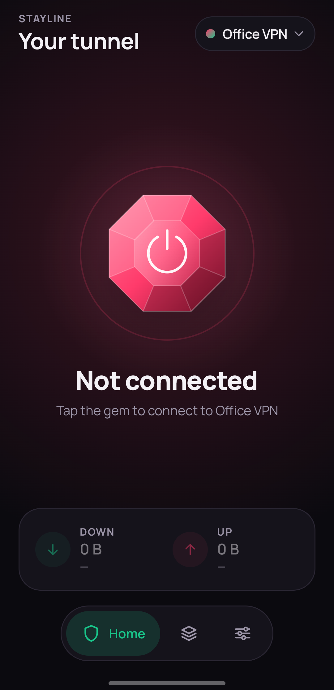
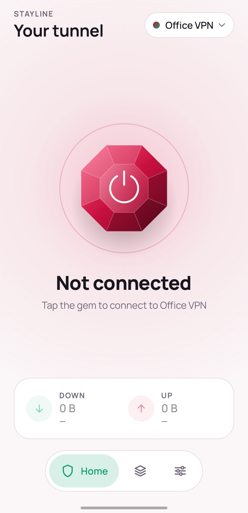
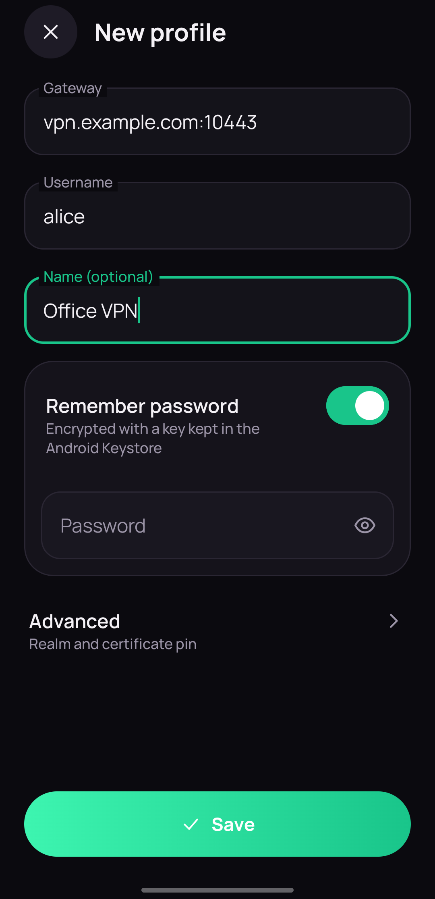

<p align="center">
  
</p>

<h1 align="center">Stayline VPN</h1>

<p align="center">
  A lightweight FortiGate SSL-VPN client for Windows and Android that stays connected.
</p>

<p align="center">
  <a href="https://github.com/priyansx01/stayline-vpn/actions/workflows/ci.yml"></a>
  <a href="https://github.com/priyansx01/stayline-vpn/releases/latest"></a>
  <a href="#license"></a>
  
</p>

<p align="center">
  
  
  
</p>

Stayline VPN connects to an existing FortiGate SSL-VPN gateway and keeps the tunnel up. When Wi-Fi drops, you switch networks or the device sleeps, it reconnects on its own, without asking for your password again or making you press Connect.

Windows and Android share the same tunnel engine, written in Rust, and the same design: a cut-gem connect button that glows ruby when off, topaz while connecting and emerald once you're protected.

## Features

- **Stays connected** — detects drops within seconds and reconnects silently, with back-off and offline detection.
- **Saved passwords, safely** — optional, encrypted with Windows DPAPI for your Windows account, or with a key held in the Android Keystore.
- **Certificate pinning** — trust a self-signed gateway once, get warned if its certificate ever changes.
- **Service + tray design on Windows** — the tunnel lives in a Windows service; closing the app never drops the VPN.
- **Android** — Always-on VPN and "Block connections without VPN", a Quick Settings tile, and IPv6 captured in full-tunnel mode so nothing leaks. No trackers and no Google services.
- **Built for IT** — company installers with the connection built in, so employees only type their username and password.
- **Small** — written in Rust: under 30 MB of RAM on Windows, and an Android APK of about 3 MB.

Works with any FortiGate SSL-VPN gateway using username and password sign-in (split or full tunnel). Not supported: SAML, token codes in the app, IPsec, posture checks, iOS, macOS and Linux.

## Install

### Windows

1. Download `stayline-<version>.msi` from the [latest release](https://github.com/priyansx01/stayline-vpn/releases/latest) — or use the installer from your IT department.
2. Run it. Stayline VPN starts automatically and at every sign-in.
3. In **Profiles**, add your gateway address and username (skip this if IT set it up), then press **Connect** on the **Status** page.

See the [user guide](docs/user-guide.md) for details. If FortiClient is connected, disconnect it first.

### Android

Stayline is on its way to [F-Droid](https://f-droid.org) (submitted, awaiting review). Until then, install it from GitHub:

1. Download the APK for your phone from the [latest release](https://github.com/priyansx01/stayline-vpn/releases/latest): `stayline-<version>-arm64-v8a.apk` suits nearly every phone from the last several years; `armeabi-v7a` is for older 32-bit phones.
2. Open it and allow installing from your browser or file manager when Android asks.
3. Add your gateway and username under **Profiles**, then tap the gem on **Home**. Android asks once to allow the VPN.

The F-Droid and GitHub builds are the same APKs, signed with the same key, so you can switch between them and keep getting updates. Signing certificate SHA-256: `1bee5aabbcd28763c287b90bf10ca55c499214219a4b3c6ae140508dfaddc8ad`.

## For IT departments

Build an installer with your gateway and certificate pin built in, or pass them to the generic MSI through Intune or Group Policy:

```powershell
msiexec /i stayline-0.2.0.msi GATEWAY=vpn.example.com:10443 PIN=<sha256> CONNECTIONNAME="Example VPN" /qn
```

The [deployment guide](docs/deployment.md) covers company installers, all options, certificate pins and managing connections.

## How it works

The `stayline-svc` Windows service logs in to the gateway, runs PPP over TLS and drives a [Wintun](https://www.wintun.net) adapter with the routes and DNS the gateway assigns. It watches LCP echoes and Windows network events, keeps the adapter in place during a drop and reconnects as soon as the network is back. The `stayline-tray` app talks to the service over a named pipe and only shows state and asks for input. Read more in [architecture](docs/architecture.md).

## Building from source

Requires Windows, the MSVC build tools and [rustup](https://rustup.rs) (the toolchain is pinned in `rust-toolchain.toml`).

```powershell
cargo build --workspace
cargo test --workspace
powershell -ExecutionPolicy Bypass -File scripts\build-installer.ps1   # MSI, needs the .NET SDK
```

See [building](docs/building.md) for running the service from a build and testing against a gateway with `stayline-probe`.

## Android

The Android app has a native Jetpack Compose interface on the same Rust tunnel as Windows. It lives in [`android/`](android), and its Rust side in [`crates/mobile`](crates/mobile). Release builds are reproducible: building a tag gives the same APKs as the release, apart from the signature. See [Android](docs/android.md) for building, releasing and how it differs from Windows.

## Project layout

| Path | Contents |
| --- | --- |
| [`crates/core`](crates/core) | FortiGate protocol, TLS and pinning, PPP, reconnect supervisor (platform independent) |
| [`crates/net`](crates/net) | Windows networking: Wintun adapter, routes, DNS, network-change events |
| [`crates/svc`](crates/svc) | Windows service and admin commands |
| [`crates/tray`](crates/tray) | Desktop app (Slint UI), tray icon, notifications |
| [`crates/config`](crates/config) | Company and user settings, saved passwords |
| [`crates/ipc`](crates/ipc) | Messages between the app and the service |
| [`crates/probe`](crates/probe) | Developer CLI for testing a gateway |
| [`crates/session`](crates/session) | Code shared by the Windows service and the Android engine |
| [`crates/mobile`](crates/mobile) | Android tunnel engine, loaded by the app over JNI |
| [`android`](android) | Android app (Kotlin, Jetpack Compose) |
| [`packaging`](packaging) | WiX installer source and licence-notice templates |
| [`scripts`](scripts) | Build, installer, notice and asset scripts |
| [`assets`](assets) | Logo, icon and installer artwork |
| [`docs`](docs) | User, deployment, architecture and build documentation |

## Contributing

Contributions are welcome — please read [CONTRIBUTING.md](CONTRIBUTING.md) and follow the [code of conduct](CODE_OF_CONDUCT.md). Report security issues privately as described in [SECURITY.md](SECURITY.md). Changes are listed in the [changelog](CHANGELOG.md).

## License

Licensed under either of

- Apache License, Version 2.0 ([LICENSE-APACHE](LICENSE-APACHE))
- MIT license ([LICENSE-MIT](LICENSE-MIT))

at your option.

## Acknowledgements

- The UI is built with [Slint](https://slint.dev), used under its royalty-free licence, which requires the "Made with Slint" attribution shown on the About page.
- [Wintun](https://www.wintun.net) by WireGuard LLC provides the network adapter.
- The [Manrope](https://github.com/googlefonts/manrope) typeface by The Manrope Project Authors is used under the SIL Open Font License 1.1.
- Protocol behaviour was learned from [openfortivpn](https://github.com/adrienverge/openfortivpn); no openfortivpn code is included.
- Every open-source component and its licence is listed on the About page and in [THIRD-PARTY-NOTICES.html](THIRD-PARTY-NOTICES.html).

Stayline VPN is not affiliated with or endorsed by Fortinet, Inc. FortiGate and FortiClient are trademarks of Fortinet, Inc.
